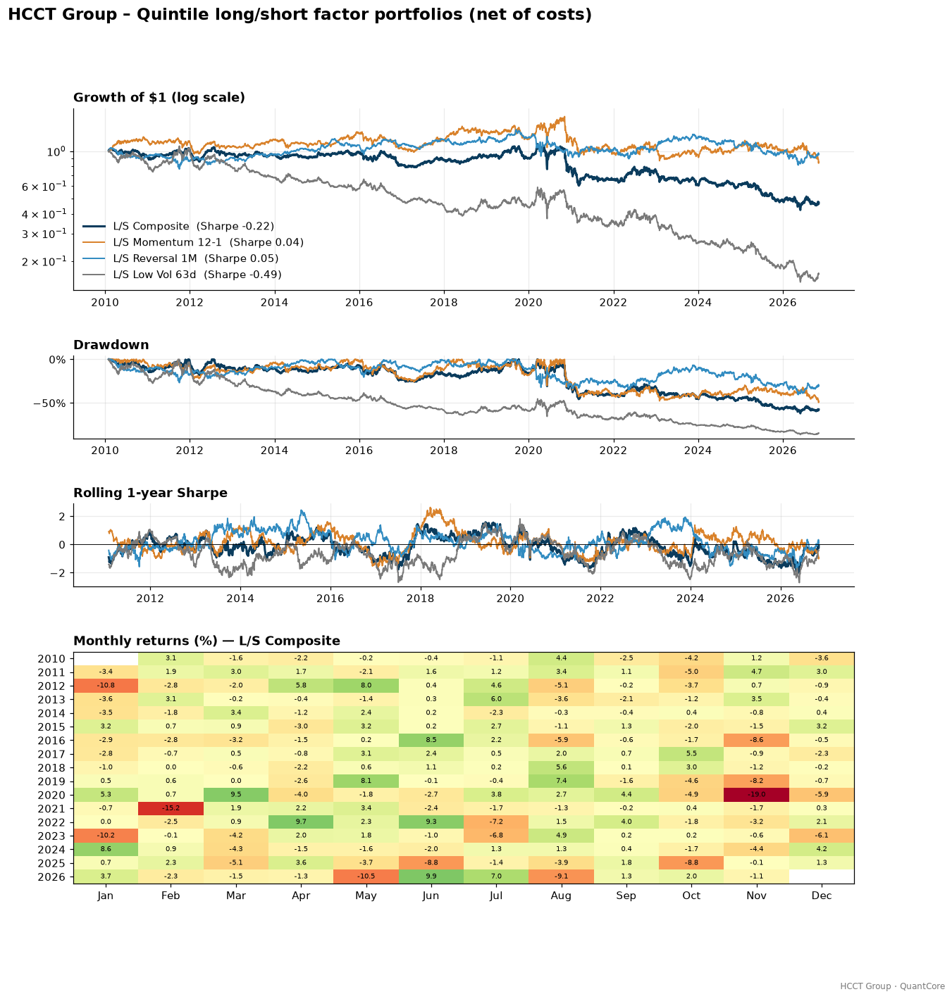
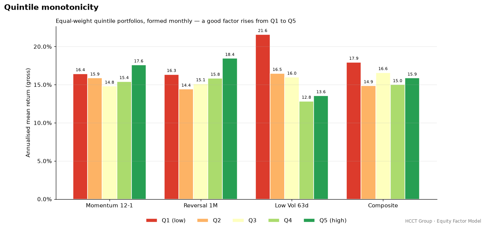
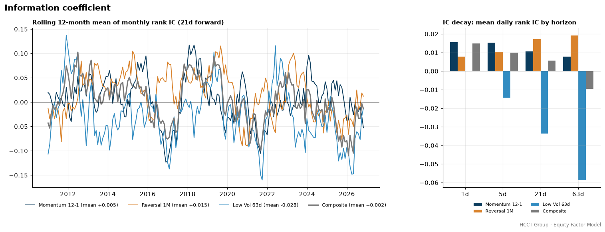
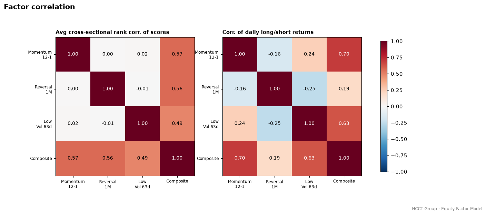
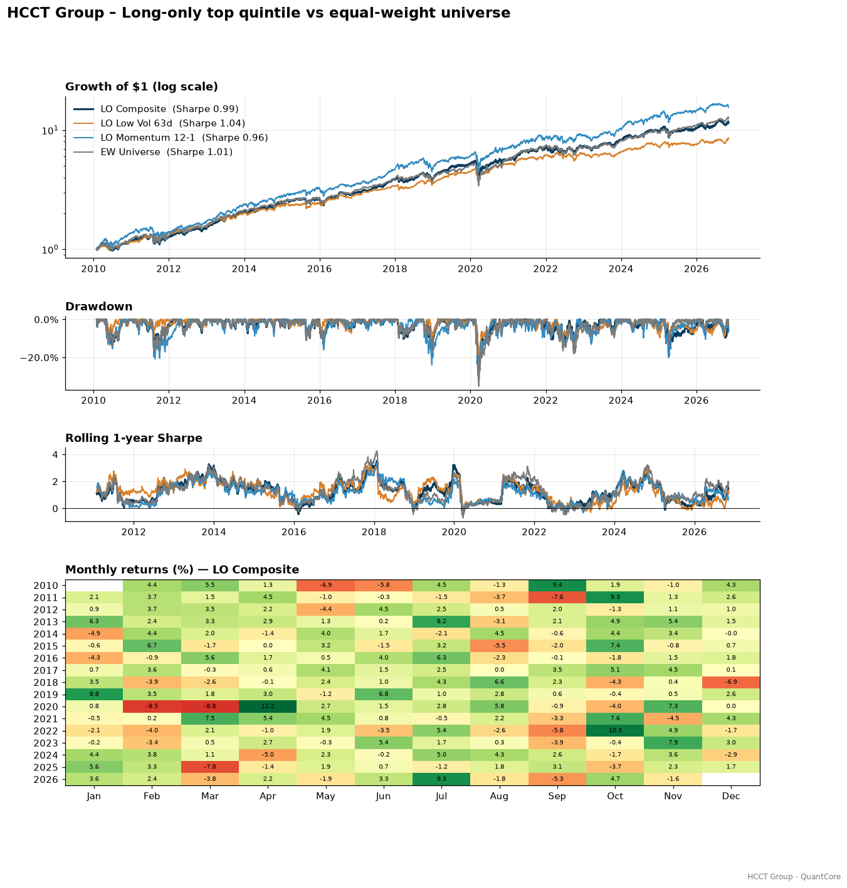

# HCCT Group – Equity Factor Model

**Cross-sectional equity factor research: rank IC, quintile long/short portfolios and Fama-French attribution.**
Created by **Harry CHU** · HCCT Group

[](https://github.com/hcctbusiness/Equity-Factor-Model/actions/workflows/ci.yml)


This repository tests whether three classic price-based equity factors (12-1 momentum, 1-month reversal and low volatility) and an equal-weight composite of them predicted returns across about 110 US large caps from 2010 to 2026. It reports the result honestly. Backtesting runs on [QuantCore](https://github.com/hcctbusiness/QuantCore), the shared HCCT Group engine. Every number below comes from `python run_factor_model.py`.



## Methodology

| Step | Implementation |
|---|---|
| Universe | 113 liquid S&P 500 large caps listed before 2010, hard-coded in `universe.py` |
| Data | Yahoo Finance adjusted closes (via `quantcore.data`), 2009-01 → today; 2009 is warm-up only |
| Momentum 12-1 | Return from t−252 to t−21 days (skips the most recent month) |
| Reversal 1M | Minus the trailing 21-day return |
| Low Vol 63d | Minus the trailing 63-day standard deviation of daily returns |
| Standardisation | Each day, winsorised at the 1st/99th cross-sectional percentile, then z-scored |
| Composite | Equal-weight average of the three z-scores, re-z-scored |
| IC | Spearman rank IC: month-end score vs next-month return; IC decay uses daily IC at 1/5/21/63-day horizons with Newey-West t-stats (lag = horizon) |
| Quintiles | Equal-weight Q1…Q5 formed at each month end, held one month |
| Long/short | Dollar-neutral: $1 long Q5 / $1 short Q1, equal weight, traded at month end then left to drift |
| Long-only | Equal-weight Q5 vs the equal-weight universe (rebalanced monthly) |
| Costs | 1 bp commission + 2 bp slippage on traded notional, plus 50 bp/yr borrow on gross shorts |
| Attribution | Daily OLS on Fama-French 5 factors + momentum (Ken French data library), Newey-West (5 lags) |

Signals use only data up to the close of day *t*. QuantCore's `lag=1` then applies them to returns from *t+1*. A unit test confirms that changing future prices leaves past factor values unchanged. As an execution-delay check, the composite is also traded one day late.

A quality or value factor is **not** included. Free sources such as Yahoo Finance only offer a few recent years of restated fundamentals, with no point-in-time history. A value or quality backtest built on that data would carry look-ahead bias, so it is left out rather than faked.

## Results on real data

Portfolio period 2010-02-01 → 2026-11-06, net of costs. Full output, including per-factor attribution and correlations, is in [`docs/results.md`](docs/results.md).

**Signal quality (monthly rank IC) and quintile spread (gross, annualised)**

| Factor | IC Mean | IC IR (ann.) | t-stat | Q1 | Q5 | Q5−Q1 |
|---|---:|---:|---:|---:|---:|---:|
| Momentum 12-1 | 0.005 | 0.07 | 0.31 | 16.44% | 17.59% | +1.15% |
| Reversal 1M | 0.015 | 0.28 | 1.17 | 16.34% | 18.45% | +2.11% |
| Low Vol 63d | −0.028 | −0.36 | −1.45 | 21.58% | 13.55% | −8.03% |
| Composite | 0.002 | 0.03 | 0.12 | 17.94% | 15.86% | −2.08% |

**Long/short quintile portfolios (net)**

| Metric | Momentum 12-1 | Reversal 1M | Low Vol 63d | Composite | Composite (+1d delay) |
|---|---:|---:|---:|---:|---:|
| CAGR | -0.92% | -0.27% | -10.15% | -4.40% | -4.21% |
| Ann. Vol | 17.94% | 14.29% | 18.48% | 15.19% | 15.22% |
| Sharpe | 0.04 | 0.05 | -0.49 | -0.22 | -0.21 |
| Max Drawdown | -49.51% | -40.50% | -86.37% | -61.96% | -58.51% |
| Annual Cost Drag | 0.90% | 1.66% | 0.89% | 1.39% | 1.39% |
| FF5+MOM alpha (t) | -4.01% (-1.71) | 0.30% (0.09) | -5.72% (-1.74) | -4.49% (-1.57) | — |

**Long-only top quintile vs equal-weight universe (net)**

| Metric | LO Momentum | LO Reversal | LO Low Vol | LO Composite | EW Universe |
|---|---:|---:|---:|---:|---:|
| CAGR | 17.81% | 17.87% | 13.57% | 15.68% | 16.29% |
| Sharpe | 0.96 | 0.93 | 1.04 | 0.99 | 1.01 |
| Max Drawdown | -31.79% | -43.22% | -27.28% | -31.20% | -35.22% |
| Excess vs EW (ann.) | 1.78% | 1.99% | -2.82% | -0.54% | — |
| Information Ratio | 0.20 | 0.25 | -0.34 | -0.08 | — |



## Reading the results honestly

- **None of the factors earned a statistically meaningful premium in this universe.** No monthly IC t-stat clears 1.5, and the composite's IC is effectively zero. After costs, no long/short book had a Sharpe ratio above 0.05.
- **Low volatility worked in reverse.** It was the only factor with a clean, monotonic quintile pattern (ρ = −0.90), but high-volatility names beat low-volatility ones by about 8% a year. A dollar-neutral low-vol book is short market beta (β = −0.47), and that bet suffered in a 2010–2026 bull market led by high-beta mega-cap tech. Even after controlling for FF5 + momentum, its alpha is still negative (−5.7%, t = −1.7). It loads positively on profitability (RMW) and investment (CMA), so it behaves like a defensive quality tilt, which lagged.
- **Momentum showed up only at short horizons.** Daily IC is significant at 1 day (t = 4.0) but fades by 21 days. The long/short book is largely explained by the Fama-French MOM factor (β = 0.91, R² = 0.71), with negative alpha, so it adds nothing beyond the textbook factor.
- **Reversal was the most robust factor, but its edge was thin.** It was positive at every horizon and worked best at 21–63 days. The top quintile beat the equal-weight universe by about 2% a year (IR 0.25) long-only. That edge is too small to survive shorting costs: the gross long/short Sharpe of 0.17 drops to 0.05 net.
- **Equal-weighting diluted the composite.** Combining a working signal (reversal) with a reversed one (low vol) cancelled out. The factors are nearly uncorrelated (score correlations ≈ 0), so blending them diversifies but cannot add a premium that isn't there. A one-day execution delay barely changes anything, so the weak result is not a timing artefact.
- **Long-only results are mostly beta.** Every long-only book is dominated by market exposure (β ≈ 0.86 for the composite) and lands close to the equal-weight universe. The composite's FF5 + MOM alpha is +1.6% with t = 0.95, which is not significant.

**Conclusion:** among liquid US mega caps since 2010, simple price-based factors have been weak to negative. That fits the factor-crowding and "factor zoo" literature. Any edge would likely require better data (point-in-time fundamentals, small caps, or a global universe), risk-neutral construction (beta- and sector-neutral), or faster signals.





## Limitations

- **Survivorship bias.** The universe is today's S&P 500 survivors, picked in hindsight. Firms that were delisted, acquired or dropped from the index between 2010 and 2026 are missing. This usually flatters long-only returns and can distort factor spreads. A professional study would use point-in-time index membership (e.g. CRSP).
- **Small, concentrated universe.** About 22 names per quintile, all mega caps. Academic factor premia are much stronger in small caps and in broader universes.
- **No risk neutralisation.** The books are dollar-neutral, not beta- or sector-neutral, so the low-vol book is largely a short-beta bet.
- **Simple cost model.** Costs are linear, with a flat borrow fee and no market impact. Trades execute at the signal-day close (QuantCore convention); the +1-day test shows this is not material here.
- **Price-only factors.** No value or quality factor is included (see Methodology). Yahoo data may contain occasional adjustment errors.
- **Attribution window.** It ends at the latest Ken French release (currently 2026-09-30). The run skips attribution gracefully if the download fails.

## Quick start

```bash
git clone https://github.com/hcctbusiness/Equity-Factor-Model.git
cd Equity-Factor-Model
pip install -e ".[dev]"      # pulls QuantCore from GitHub
pytest -q                    # 13 offline tests on synthetic data
python run_factor_model.py   # downloads data, regenerates docs/
```

```python
import quantcore as qc
from factor_model import factors, analytics, portfolio
from factor_model.universe import TICKERS

px = qc.data.prices(TICKERS, start="2009-01-01")
scores = factors.build_factors(px)
ic = analytics.rank_ic(scores["Composite"], analytics.forward_returns(px, 21))
res = portfolio.run(portfolio.long_short_targets(scores["Composite"]), px,
                    qc.CostModel(1, 2, borrow_bps_annual=50), name="L/S Composite")
print(analytics.ic_summary(ic, horizon=21), res.stats())
```

## Project structure

```
src/factor_model/
  universe.py      # hard-coded large-cap universe
  factors.py       # momentum, reversal, low vol, winsorize, z-score, composite
  analytics.py     # rank IC, Newey-West t-stats, IC decay, quintiles, correlations
  portfolio.py     # quintile long/short & long-only targets, monthly drift-and-rebalance
  attribution.py   # Ken French FF5 + MOM download/cache, HAC OLS
  plots.py         # quintile, IC and correlation charts
run_factor_model.py  # reproduces every chart and table in this README
tests/               # offline unit tests (z-score, IC, quintiles, dollar neutrality, OLS)
```

## HCCT Group quant research series

| Project | Focus |
|---|---|
| [QuantCore](https://github.com/hcctbusiness/QuantCore) | Backtesting engine |
| [Macro-AI-Copilot](https://github.com/hcctbusiness/Macro-AI-Copilot) | Macro regime detection → multi-asset allocation |
| **Equity Factor Model** | Cross-sectional factors, long/short, IC analysis (this repo) |
| HK Stat-Arb | Cointegration pairs and A/H-share premium |
| Multi-Asset Trend Following | Futures-style CTA with vol targeting |
| ML Alpha Lab | Purged CV, meta-labelling, gradient boosting |
| Portfolio & Risk Engine | HRP, risk parity, Black-Litterman, VaR |

## Disclaimer

For research and education only. Not investment advice. Past performance does not guarantee future results.

---
© 2026 Harry CHU · HCCT Group · MIT License
